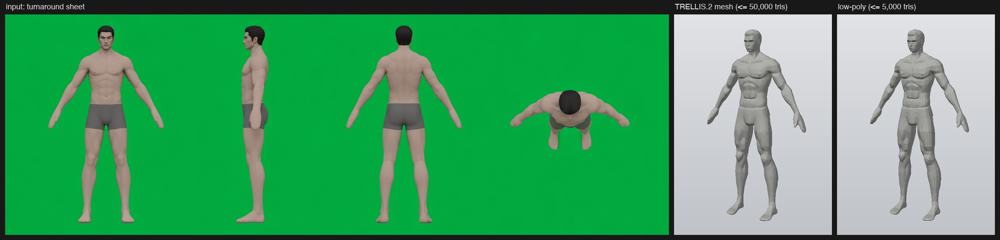
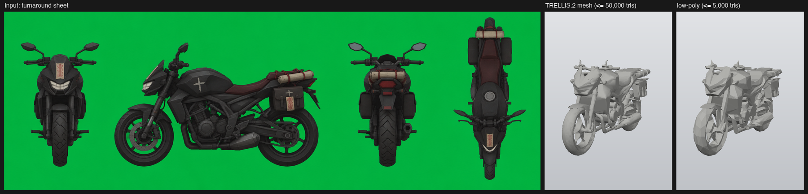
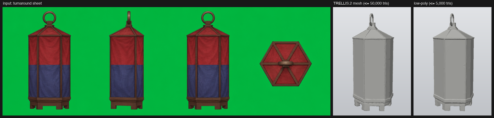
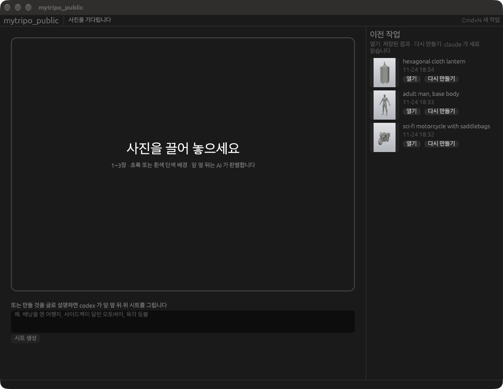
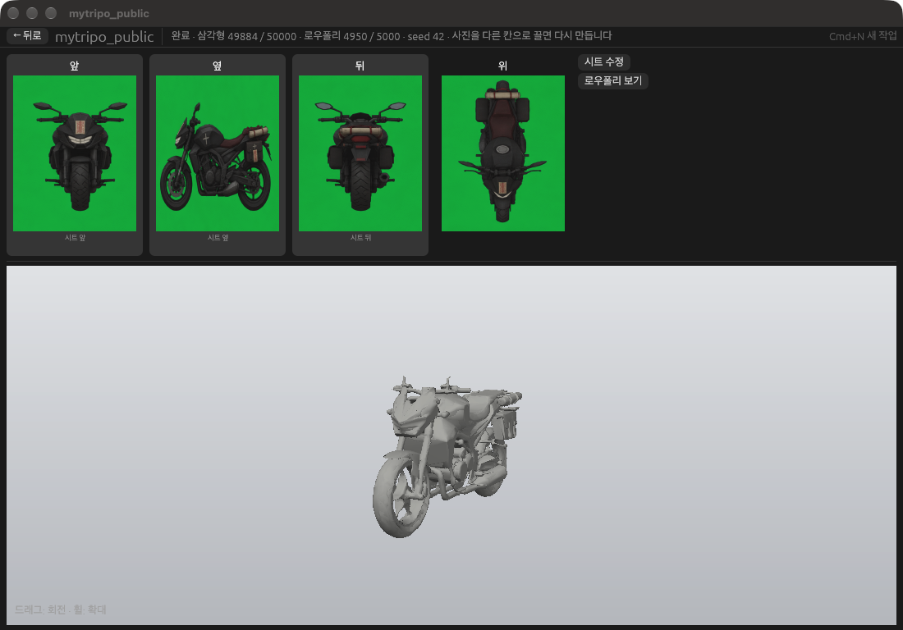

# mytripo_public

사진이나 턴어라운드 시트 한 장에서 Blender 용 `.glb` 메시와 로우폴리 판을 만드는 macOS 앱입니다. 형태는 로컬에서 도는 [TRELLIS.2](https://github.com/microsoft/TRELLIS.2) 가 만듭니다.

A macOS app that turns photos or one turnaround sheet into a Blender-ready `.glb` mesh and a low-poly version. The shape comes from [TRELLIS.2](https://github.com/microsoft/TRELLIS.2), running locally.

> **Built with [TRELLIS.2](https://github.com/microsoft/TRELLIS.2) (Microsoft, MIT)**
>
> 이 앱의 3D 형태는 Microsoft 의 image-to-3D 모델 **TRELLIS.2**(`microsoft/TRELLIS.2-4B`)가 만듭니다. 이 저장소는 TRELLIS.2 를 부르는 앱과 후처리(칸 맞추기, 로우폴리, 뼈대)이고, 모델의 코드와 가중치는 담지 않습니다. Apple Silicon 실행은 [trellis-mac](https://github.com/shivampkumar/trellis-mac) 과 [Pedro Naugusto 의 Metal 포트](https://github.com/pedronaugusto/trellis2-apple)를 씁니다. 이 프로젝트는 Microsoft 와 관계가 없습니다.
>
> The 3D shape in this app is generated by **TRELLIS.2** (`microsoft/TRELLIS.2-4B`), Microsoft's image-to-3D model. This repository is the app that calls TRELLIS.2 plus the post-processing (fitting to the views, low-poly, skeleton); it contains none of the model's code or weights. Running on Apple Silicon relies on [trellis-mac](https://github.com/shivampkumar/trellis-mac) and [Pedro Naugusto's Metal ports](https://github.com/pedronaugusto/trellis2-apple). This project is not affiliated with Microsoft.

**[한국어](#한국어) · [English](#english)**

자유롭게 쓰고, 고치고, 배포해도 됩니다. 도움이 되었다면 ⭐ 스타 하나만 눌러 주세요.

Feel free to use, modify and redistribute it. If it helps you, please leave a ⭐ star.

## 예시 · Samples

입력 시트(왼쪽), TRELLIS.2 메시(가운데), 로우폴리 판(오른쪽)입니다. 설정은 `1024_cascade` + remesh, seed 42 입니다.

Input sheet (left), TRELLIS.2 mesh (middle), low-poly version (right). Settings: `1024_cascade` + remesh, seed 42.





| 대상 · Subject | 실루엣 IoU 앞/옆/뒤/위 · Silhouette IoU front/side/back/top | 로우폴리 IoU · Low-poly IoU | 삼각형 · Triangles | 모델 시간 · Model time |
|---|---|---|---|---|
| 사람 · person | 0.927 / 0.866 / 0.925 | 0.927 / 0.867 / 0.924 | 4950 | 161 s + 23 s |
| 오토바이 · motorcycle | 0.768 / 0.891 / 0.751 / 0.755 | 0.771 / 0.903 / 0.762 / 0.760 | 4950 | 498 s (불러오기 포함 · incl. loading) |
| 등불 · lantern | 0.939 / 0.944 / 0.938 / 0.768 | 0.938 / 0.941 / 0.936 / 0.768 | 4950 | 196 s + 35 s |

사람과 등불의 시간은 생성 + 메시 정리이고, 모델 불러오기 2~3분이 따로 듭니다. For the person and the lantern, time is generation + mesh cleanup; loading the model takes another 2–3 minutes.

### 앱 화면 · App

| 시작 화면 · Start | 결과 화면 · Result |
|---|---|
|  |  |

---

## 한국어

### 하는 일
- 사진 1~3장(초록 또는 흰색 단색 배경)이나 앞·옆·뒤·위가 한 장에 든 턴어라운드 시트를 받습니다.
- 글 설명으로 시트 생성을 지시하면 `codex` CLI 가 시트를 그립니다.
- `claude` CLI 가 시점(앞·옆·뒤), 사람 여부, 관절점을 읽습니다.
- TRELLIS.2 가 사진 한 장(사물은 옆, 사람은 앞)으로 형태를 만들고, 앱이 그 메시를 시트의 칸에 맞춥니다.
- Blender 가 삼각형 5000개 이하의 로우폴리 판을 만듭니다.
- 사람형은 뼈 65개를 넣은 `.rig.glb` 도 냅니다. 뼈대는 Universal Animation Library(Quaternius, CC0)의 마네킹과 이름·구조·rest 방향이 같습니다.
- 결과는 Y-up, 미터 단위, 발바닥 원점, 메시 1개, 회색 재질 1개입니다.

### 필요한 것
- Apple Silicon Mac, 메모리 24 GB 이상 권장
- Rust(`cargo`), [Blender](https://www.blender.org)(`brew install --cask blender`)
- 로그인된 `claude` CLI(구조 읽기). `codex` CLI(시트 생성)는 선택입니다. 없으면 [그림을 직접 준비](#codex-없이-쓰기)합니다. 앱은 API 키를 받지 않습니다.
- 로컬 모델: 환경 약 2 GB, 가중치 약 16 GB

### 로컬 모델 설치
1. Metal 툴체인을 받습니다: `xcodebuild -downloadComponent MetalToolchain`
2. Hugging Face 에 로그인합니다: `hf auth login`
3. <https://huggingface.co/facebook/dinov3-vitl16-pretrain-lvd1689m> 에서 접근 승인을 받습니다.
4. 설치합니다: `bash scripts/setup_model.sh`

정상이면 마지막 줄이 `✓ model ready: torch …, mps True, postprocess metal` 입니다. 위치는 `MYTRIPO_PUBLIC_MODEL_DIR`(기본 `~/Documents/mytripo_public/model`)입니다. 가중치는 첫 생성 때 Hugging Face 캐시에 내려받습니다.

모델을 설치하지 않으면 앱은 사람형을 단면 로프트로, 사물을 부품 조립으로 만듭니다(예산 2000 삼각형).

### codex 없이 쓰기
`codex` CLI 는 시트를 그릴 때만 씁니다. `codex` 가 없으면 그림을 직접 준비해서 넣으면 됩니다. 어떤 도구(이미지 생성 서비스, Blender 렌더, 직접 그린 그림, 사진)로 만들어도 됩니다.

**사진 1~3장으로 넣기**
- 앞, 옆, 뒤에서 찍은 사진입니다. 한 장만 있어도 됩니다(사물은 옆, 사람은 앞).
- 배경은 초록 또는 흰색 단색입니다. 그림자와 바닥이 없어야 합니다.
- 대상 전체가 잘리지 않고 들어가야 합니다.

**턴어라운드 시트 한 장으로 넣기**
- 가로로 긴 그림 한 장에 같은 대상을 왼쪽부터 앞, 옆, 뒤, 위 순서로 한 줄에 놓습니다. 위는 없어도 됩니다. 권장 크기는 3072x1024 입니다.
- 옆 모습은 그림의 왼쪽을 바라봅니다. 위 모습은 대상의 앞이 그림의 아래쪽을 향합니다.
- 원근이 없는 직교 시점이고, 네 모습의 축척이 같습니다. 앞·옆·뒤는 머리 끝과 바닥 선이 같은 높이입니다.
- 배경은 초록 단색(`#00B140`)입니다. 모습 사이와 그림 가장자리에 그림 너비의 5% 이상을 비웁니다. 앱은 이 빈 띠에서 칸을 자릅니다.
- 그림자, 바닥, 글자, 화살표, 테두리를 넣지 않습니다.
- 사람은 A포즈입니다. 팔은 몸통에서 30~40도 벌리고, 다리 사이를 띄우고, 손가락은 모읍니다.

다른 이미지 생성 도구를 쓸 때는 위 조건을 프롬프트로 주면 됩니다. 앱이 `codex` 에 주는 프롬프트 원문은 `src/sheet.rs` 의 `RULES` 에 있습니다.

준비한 그림은 창에 끌어 놓거나 아래처럼 넣습니다. 시점과 관절점을 읽는 `claude` CLI 는 이 경우에도 필요합니다.
```bash
cargo run --release -- --sheet-file my_sheet.png                          # 창에서 시작
cargo run --release --example headless -- --sheet-file my_sheet.png       # 창 없이
cargo run --release --example headless -- front.png side.png back.png    # 사진으로
```

### 앱 실행
```bash
cargo run --release                              # 창을 엽니다. 사진을 끌어 놓습니다
cargo run --release -- --sheet-file sheet.png    # 시트로 바로 시작합니다
bash scripts/make_app.sh                         # ~/Desktop/mytripo_public.app 을 만듭니다
```
결과는 `~/Documents/mytripo_public/<yyyyMMdd-HHmmss>.glb`, `.low.glb`, `.rig.glb`(사람형)로 저장됩니다.

### CLI 사용법
창 없이 같은 경로를 한 번 돌립니다.
```bash
# 사진 1~3장 → .glb
cargo run --release --example headless -- front.png side.png back.png
# 턴어라운드 시트 → .glb
cargo run --release --example headless -- --sheet-file sheet.png
# 글 설명 → codex 가 시트 생성 → .glb (참고 사진은 선택)
cargo run --release --example headless -- --sheet "사이드백이 달린 오토바이" ref.png
# 시트만 수정
cargo run --release --example headless -- --edit sheet.png "바퀴를 더 크게"
# 같은 인물의 자세 시트(앞·옆·3/4). 동작의 참고 그림입니다
cargo run --release --example headless -- --pose-sheet "웅크린 방어 자세" sheet.png
```

| 선택 인자 | 뜻 |
|---|---|
| `--structure <json>` | `claude` 를 부르지 않고 저장된 구조 응답을 씁니다 |
| `--raw <ply>` | 모델을 돌리지 않고 저장된 모델 메시(`<시각>.model.ply`)를 씁니다 |
| `--model-output <ply>` | 모델이 낸 그대로의 PLY 를 정리해서 씁니다 |
| `--seed <n>` | 모델의 seed(기본 42). 가려진 쪽의 형태가 달라집니다 |
| `--budget <n>` | 삼각형 예산 |
| `--no-model` | 로컬 모델을 쓰지 않습니다 |
| `--model-input <png>` | 모델에 넣는 그림(배경을 지운 RGBA)을 저장합니다 |

구독을 쓰지 않고 fixture 로 확인하는 예입니다.
```bash
cargo run --release --example headless -- --sheet-file test/fixtures/moto_sf_sheet.png \
  --structure test/fixtures/moto_sf_sheet_structure.json --raw test/fixtures/moto_sf_model.ply
```
출력의 `Front/Side/Back/Top IoU`, `low … IoU`, `saved`, `low preview` 줄을 읽습니다.

| 환경변수 | 뜻 |
|---|---|
| `MYTRIPO_PUBLIC_MODEL_DIR` | 모델 폴더 |
| `MYTRIPO_PUBLIC_PIPELINE` | `1024_cascade`(기본) 또는 `512`(약 3배 빠르지만 얇은 표면이 깨질 수 있습니다) |
| `MYTRIPO_PUBLIC_REMESH` | `1`(기본) 또는 `0`(dual contouring remesh 를 끕니다) |

사람형 `.rig.glb` 에 동작을 넣습니다. 자세 JSON 의 형식은 `scripts/blender_anim.py` 머리 주석에 있고, 예는 `test/fixtures/pose_guard.json` 입니다.
```bash
blender -b --factory-startup --python-exit-code 1 --python scripts/blender_anim.py -- make  rig.glb pose.json anim.glb
blender -b --factory-startup --python-exit-code 1 --python scripts/blender_anim.py -- check anim.glb pose.json
blender -b --factory-startup --python-exit-code 1 --python scripts/blender_anim.py -- sheet anim.glb pose.json sheet.png
```

### 검증
`bash scripts/verify.sh` 를 실행합니다. 마지막 줄이 `✓ verify passed` 이면 통과입니다. 이 명령은 구독 CLI 와 로컬 모델을 부르지 않고 Blender 는 부릅니다.

### 한계
- 모델은 사진 한 장만 봅니다. 가려진 쪽은 모델의 추정입니다.
- 결과 메시는 색과 텍스처가 없습니다.
- 대상 하나에 3~10분이 걸립니다.
- 몸체와 떨어진 작은 조각(겉넓이의 0.2% 미만)은 앱이 떠 있는 조각으로 보고 버립니다. 예시의 오토바이는 이 때문에 거울이 없습니다.
- 설치 스크립트는 `uv` 가 있는 환경에서만 확인했습니다. `scripts/make_app.sh` 는 번들을 만드는 것까지 확인했고, 그 번들의 실행은 확인하지 않았습니다.
- 측정은 입력 3개, seed 42 하나로 했습니다. macOS 만 지원합니다.
- 예시의 사람 메시와 등불 메시는 같은 설정으로 미리 생성한 메시를 앱의 후처리에 넣은 결과입니다. 오토바이는 이 저장소의 설치 스크립트와 앱으로 처음부터 생성했습니다.

### 라이선스와 외부 구성 요소
이 저장소의 코드는 자유롭게 쓰고, 고치고, 배포해도 됩니다. 도움이 되었다면 ⭐ 스타 하나만 눌러 주세요.

이 저장소는 아래 구성 요소의 코드와 가중치를 담지 않습니다. 설치 스크립트가 각 원 저장소에서 받습니다.
- [TRELLIS.2](https://github.com/microsoft/TRELLIS.2) 코드와 가중치: MIT (Microsoft)
- [trellis-mac](https://github.com/shivampkumar/trellis-mac): MIT
- [utils3d](https://github.com/EasternJournalist/utils3d): MIT
- [mtlbvh](https://github.com/pedronaugusto/mtlbvh), [mtldiffrast](https://github.com/pedronaugusto/mtldiffrast), [mtlmesh](https://github.com/pedronaugusto/mtlmesh), [mtlgemm](https://github.com/pedronaugusto/mtlgemm), [trellis2-apple](https://github.com/pedronaugusto/trellis2-apple): MIT
- DINOv3 가중치: Meta DINOv3 License (접근 승인 필요)
- 뼈대 `schema/mannequin_skeleton.json`: Universal Animation Library (Quaternius), CC0
- 배경 제거 모델 RMBG-2.0(CC BY-NC 4.0)은 쓰지 않고 내려받지 않습니다.

---

## English

### What it does
- Takes 1–3 photos (solid green or white background) or one turnaround sheet with front, side, back and top views.
- Given a text description, the `codex` CLI draws the sheet.
- The `claude` CLI reads the views, whether the subject is a person, and the joint points.
- TRELLIS.2 builds the shape from one image (side view for objects, front view for people). The app fits that mesh to the sheet's views.
- Blender makes a low-poly version of at most 5,000 triangles.
- For a person, the app also writes a `.rig.glb` with 65 bones. The skeleton has the same bone names, hierarchy and rest orientations as the Universal Animation Library mannequin (Quaternius, CC0).
- Output is Y-up, in meters, origin at the soles, one mesh, one gray material.

### Requirements
- Apple Silicon Mac, 24 GB of memory or more recommended
- Rust (`cargo`), [Blender](https://www.blender.org) (`brew install --cask blender`)
- Logged-in `claude` CLI (structure reading). The `codex` CLI (sheet generation) is optional; without it, [prepare the images yourself](#without-codex). The app takes no API keys.
- Local model: about 2 GB for the environment, about 16 GB for the weights

### Install the local model
1. Download the Metal toolchain: `xcodebuild -downloadComponent MetalToolchain`
2. Log in to Hugging Face: `hf auth login`
3. Request access at <https://huggingface.co/facebook/dinov3-vitl16-pretrain-lvd1689m>.
4. Install: `bash scripts/setup_model.sh`

On success the last line is `✓ model ready: torch …, mps True, postprocess metal`. The location is `MYTRIPO_PUBLIC_MODEL_DIR` (default `~/Documents/mytripo_public/model`). Weights are downloaded into the Hugging Face cache on the first generation.

Without the model, the app builds people as a cross-section loft and objects from extruded parts (2,000-triangle budget).

### Without codex
The `codex` CLI is only used to draw sheets. Without it, prepare the images yourself and feed them in. Any tool works: an image-generation service, a Blender render, a drawing, or photos.

**As 1–3 photos**
- Photos from the front, side and back. One is enough (side for an object, front for a person).
- Solid green or white background, no shadows and no floor.
- The whole subject is in frame, nothing cropped.

**As one turnaround sheet**
- One wide image with the same subject in a single row, left to right: front, side, back, top. The top view is optional. Recommended size is 3072x1024.
- The side view faces the left edge of the image. In the top view the front of the subject points to the bottom edge.
- Orthographic views with no perspective, all at the same scale. Front, side and back share the same top line and baseline.
- Solid chroma green background (`#00B140`). Leave empty gaps of at least 5% of the image width between views and along every edge. The app splits the sheet at these gaps.
- No shadows, floor, text, arrows or frames.
- People stand in an A-pose: arms 30–40 degrees away from the torso, a clear gap between the legs, fingers together.

With another image generator, give it these rules as the prompt. The exact prompt the app sends to `codex` is `RULES` in `src/sheet.rs`.

Drop the image on the window or pass it as below. The `claude` CLI, which reads the views and joint points, is still needed.
```bash
cargo run --release -- --sheet-file my_sheet.png                          # start in the window
cargo run --release --example headless -- --sheet-file my_sheet.png       # no window
cargo run --release --example headless -- front.png side.png back.png    # from photos
```

### Run the app
```bash
cargo run --release                              # opens the window; drop photos on it
cargo run --release -- --sheet-file sheet.png    # start from a sheet
bash scripts/make_app.sh                         # builds ~/Desktop/mytripo_public.app
```
Results are saved as `~/Documents/mytripo_public/<yyyyMMdd-HHmmss>.glb`, `.low.glb` and `.rig.glb` (people).

### CLI usage
Runs the same path once, without a window.
```bash
# 1–3 photos → .glb
cargo run --release --example headless -- front.png side.png back.png
# turnaround sheet → .glb
cargo run --release --example headless -- --sheet-file sheet.png
# description → codex draws the sheet → .glb (reference photos are optional)
cargo run --release --example headless -- --sheet "a motorcycle with saddlebags" ref.png
# edit a sheet only
cargo run --release --example headless -- --edit sheet.png "make the wheels larger"
# pose sheet of the same character (front, side, three-quarter); a reference for animation
cargo run --release --example headless -- --pose-sheet "hunched guard stance" sheet.png
```

| Option | Meaning |
|---|---|
| `--structure <json>` | use a saved structure response instead of calling `claude` |
| `--raw <ply>` | use a saved model mesh (`<stamp>.model.ply`) instead of running the model |
| `--model-output <ply>` | clean and use a PLY exactly as a model wrote it |
| `--seed <n>` | model seed (default 42); changes the hidden side |
| `--budget <n>` | triangle budget |
| `--no-model` | do not use the local model |
| `--model-input <png>` | save the image given to the model (RGBA, background removed) |

An example that uses no subscription, only fixtures:
```bash
cargo run --release --example headless -- --sheet-file test/fixtures/moto_sf_sheet.png \
  --structure test/fixtures/moto_sf_sheet_structure.json --raw test/fixtures/moto_sf_model.ply
```
Read the `Front/Side/Back/Top IoU`, `low … IoU`, `saved` and `low preview` lines of the output.

| Environment variable | Meaning |
|---|---|
| `MYTRIPO_PUBLIC_MODEL_DIR` | model folder |
| `MYTRIPO_PUBLIC_PIPELINE` | `1024_cascade` (default) or `512` (about 3× faster; thin surfaces can break up) |
| `MYTRIPO_PUBLIC_REMESH` | `1` (default) or `0` (turns off dual contouring remesh) |

Add motion to a person's `.rig.glb`. The pose JSON format is in the header of `scripts/blender_anim.py`; an example is `test/fixtures/pose_guard.json`.
```bash
blender -b --factory-startup --python-exit-code 1 --python scripts/blender_anim.py -- make  rig.glb pose.json anim.glb
blender -b --factory-startup --python-exit-code 1 --python scripts/blender_anim.py -- check anim.glb pose.json
blender -b --factory-startup --python-exit-code 1 --python scripts/blender_anim.py -- sheet anim.glb pose.json sheet.png
```

### Verify
Run `bash scripts/verify.sh`. It passes when the last line is `✓ verify passed`. It does not call the subscription CLIs or the local model; it does call Blender.

### Limits
- The model sees one image. The hidden side is the model's guess.
- Output meshes have no color and no texture.
- One subject takes 3–10 minutes.
- Small pieces detached from the body (under 0.2% of the surface area) are treated as floaters and dropped. This is why the sample motorcycle has no mirrors.
- The setup script was verified only on a machine with `uv`. `scripts/make_app.sh` was verified to build the bundle; launching that bundle was not verified.
- Measurements used three inputs and one seed (42). macOS only.
- The person and lantern samples are meshes generated earlier with the same settings and passed through this app's post-processing. The motorcycle was generated from scratch with this repository's setup script and app.
- The app's UI text and the code comments are in Korean.

### License and third-party components
You may freely use, modify and redistribute the code in this repository. If it helps you, please leave a ⭐ star.

This repository contains none of the code or weights below. The setup script fetches them from their own repositories.
- [TRELLIS.2](https://github.com/microsoft/TRELLIS.2) code and weights: MIT (Microsoft)
- [trellis-mac](https://github.com/shivampkumar/trellis-mac): MIT
- [utils3d](https://github.com/EasternJournalist/utils3d): MIT
- [mtlbvh](https://github.com/pedronaugusto/mtlbvh), [mtldiffrast](https://github.com/pedronaugusto/mtldiffrast), [mtlmesh](https://github.com/pedronaugusto/mtlmesh), [mtlgemm](https://github.com/pedronaugusto/mtlgemm), [trellis2-apple](https://github.com/pedronaugusto/trellis2-apple): MIT
- DINOv3 weights: Meta DINOv3 License (gated access)
- Skeleton `schema/mannequin_skeleton.json`: Universal Animation Library (Quaternius), CC0
- The background-removal model RMBG-2.0 (CC BY-NC 4.0) is not used and not downloaded.
